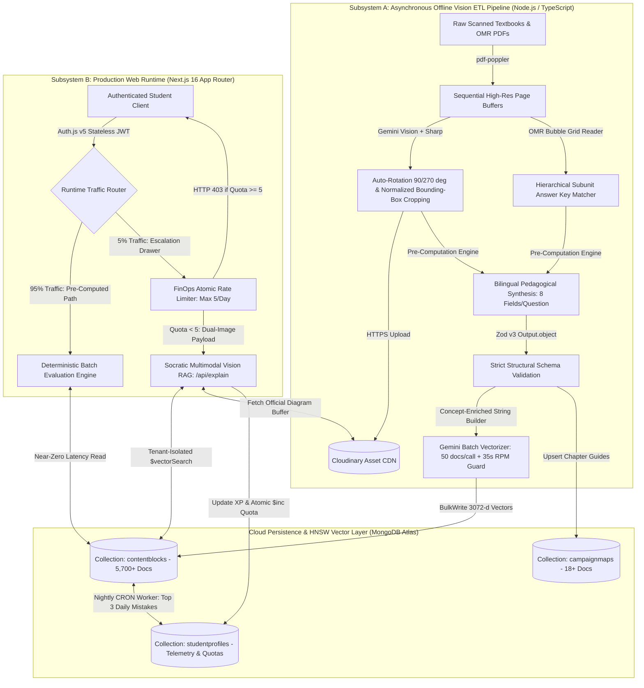

# Multimodal RAG & Adaptive Learning Engine
### Production System Architecture, LLM FinOps Specification & Engineering Post-Mortems

[](https://nextjs.org/)
[](https://www.typescriptlang.org/)
[](https://www.mongodb.com/products/platform/atlas-vector-search)
[](https://sdk.vercel.ai/)
[](https://deepmind.google/technologies/gemini/)
[](https://zod.dev/)

**Live Production Environment:** [**https://ai.learningwithsmartness.in**](https://ai.learningwithsmartness.in)

> **Repository Notice:** Because the **Multimodal RAG & Adaptive Learning Engine** serves a live, monetized production deployment under client ownership (`LearningWithSmartness`), the underlying source repositories (the offline Vision ETL ingestion pipeline and the Next.js production web runtime) are private. This repository serves as the public **System Architecture Specification & Engineering Whitepaper** detailing the distributed data topology, FinOps cost-control mechanics, and production post-mortems.

---

## 1. Executive Summary & Production Telemetry

The **Multimodal RAG & Adaptive Learning Engine** is a decoupled, high-concurrency B2B/B2C EdTech platform engineered to automate unstructured textbook digitization, deterministic assessment delivery, and Socratic multimodal tutoring for regional competitive examinations.

Standard LLM-wrapper architectures fail in high-volume educational environments due to unbounded API token burn, $3\text{--}7\text{ second}$ synchronous inference latency, and unstructured JSON parsing failures. This platform resolves those bottlenecks by separating heavy multimodal Vision extraction and pedagogical synthesis into an **asynchronous offline ETL pipeline**, allowing the **live production runtime** to serve $95\%$ of traffic through a near-zero latency pre-computed execution path while gating live Multimodal Vision RAG escalations to a strict $5\%$ atomic daily quota.

### Production Scale & Telemetry Metrics
| Metric Category | Production Telemetry | Architectural Impact |
| :--- | :--- | :--- |
| **Total Registered Students** | **5,000+ Active Users** | Sustained across desktop and low-bandwidth ($360\text{px}\text{--}440\text{px}$) mobile viewports. |
| **Daily Active Users (DAU)** | **500+ Concurrent Daily Users** | High-concurrency traffic spikes during scheduled competitive exam windows. |
| **Processed Test Submissions** | **26,000+ Submissions (114.10 MB)** | Stored across 257 live competitive exam forms with real-time All-India Rank (AIR) aggregation. |
| **Vectorized Knowledge Base** | **5,700+ Bilingual Records** | Indexed via $3072\text{-dimensional}$ Cosine HNSW graphs in MongoDB Atlas (`contentblocks`). |
| **LLM Token Cost Reduction** | **95% Runtime Inference Reduction** | Shifted from synchronous per-click LLM inference to pre-computed deterministic evaluation. |

---

## 2. System Architecture Flowchart

The **Multimodal RAG & Adaptive Learning Engine** is architected as two strictly decoupled microservices communicating across a shared **MongoDB Atlas** operational and vector data layer, alongside a **Cloudinary CDN** media store:

1. **Subsystem A — Offline Asynchronous Vision ETL & Nightly Router (Node.js / TypeScript CLI):** Handles compute-intensive PDF slicing, page rotation normalization, bounding-box image cropping, OMR bubble grid matching, bilingual pedagogical pre-computation, rate-limited batch vectorization, and nightly semantic weakness routing.
2. **Subsystem B — High-Concurrency Production Web Runtime (Next.js 16 App Router):** Handles stateless JWT authentication, pre-computed batch quiz delivery, atomic FinOps quota enforcement, and on-demand dual-image Multimodal Vision RAG tutoring.



---

## 3. Core Engineering Pillars

### Pillar 1: LLM FinOps & Deterministic Runtime Routing


In Phase 1 of the system, executing a synchronous embedding lookup and LLM generation call on every multiple-choice question (MCQ) submission introduced $3\text{--}7\text{ seconds}$ of runtime latency and unsustainable API token consumption during peak exam traffic.

To eliminate unbounded inference costs without sacrificing pedagogical depth, the runtime was refactored into a **Hybrid FinOps Architecture**:

* **Asynchronous Pedagogical Pre-Computation:** During offline ingestion, the ETL pipeline downloads each question's cropped Cloudinary diagram buffer and invokes Gemini with the verified OMR answer key to pre-generate **8 structured bilingual fields** (Marathi and English): core concept summary, step-by-step derivation, competitive exam shortcut trick, and visual analogy.
* **Near-Zero Latency Pre-Computed Execution Path ($95\%$ Traffic):** When a student launches a practice session, `/api/practice` pre-loads a level-sorted batch of 20 questions (`Easy 1` $\rightarrow$ `Medium 2` $\rightarrow$ `Hard 3`) and resolves shared reading passages (`sharedReferenceId`) in a single bulk query. Standard grading and bilingual explanation toggling execute deterministically against pre-computed records, bypassing live LLM inference entirely.
* **Idempotent Batch Embedding & Free-Tier Rate-Limit Engineering:** Vector generation is restricted to unembedded records (`{ $or: [{ embedding: null }, { embedding: { $size: 0 } }] }`), processed in batches of 50 via `embedMany`, persisted in a single `bulkWrite` operation, and guarded by a $35\text{-second}$ RPM sleep timer with an automated $65\text{-second}$ exponential backoff cooldown on HTTP `429 RESOURCE_EXHAUSTED` exceptions.

---

### Pillar 2: Socratic Dual-Image Multimodal Vision RAG (`/api/explain`)


When pre-computed step-by-step explanations are insufficient—such as when a student makes an arithmetic or geometric error in their physical notebook—the platform exposes an on-demand **Multimodal Escalation Drawer** governed by strict FinOps and pedagogical guardrails:

1. **Atomic FinOps Quota Gate:** Before invoking any external AI SDK, the `/api/explain` route inspects `profile.dailyAiRequests`. If the counter is $\ge 5$, the endpoint immediately short-circuits with `HTTP 403 Forbidden`, preventing quota exhaustion and guaranteeing a strict daily cost ceiling per user.
2. **Semantic Theory Retrieval:** The student's natural-language query is concatenated with the question text, embedded into a $3072\text{-dimensional}$ vector, and passed to a MongoDB `$vectorSearch` stage against `vector_index` to retrieve supporting chapter theory blocks.
3. **In-Memory Dual-Image Buffer Assembly:** The backend fetches the official question diagram buffer from Cloudinary (`questionImageUrl`) and pairs it in memory with the student's uploaded photo of their **handwritten notebook rough work** (`FormData` image payload).
4. **Socratic Ground-Truth Prompting:** Both images and the pre-computed `solution_stepByStep` ground truth are injected into a constrained system prompt that instructs Gemini Vision to cross-examine the student's handwritten steps against the official diagram, identify the exact line where the student's calculation deviated, and return a Socratic hint without revealing the final answer.
5. **Atomic State Mutation:** Upon successful inference, the student's quota is incremented atomically via MongoDB's `$inc` operator:

```typescript
// Atomic FinOps Quota Enforcement & Socratic RAG Mutation
const updatedProfile = await StudentProfileModel.findOneAndUpdate(
  { username: session.user.username, dailyAiRequests: { $lt: 5 } },
  { $inc: { dailyAiRequests: 1 } },
  { upsert: false, returnDocument: "after" }
);

if (!updatedProfile) {
  return NextResponse.json(
    { error: "Daily AI Tutor limit (5/5) reached to prevent server overload." },
    { status: 403 }
  );
}
```

---

### Pillar 3: The Vector Firewall (Index-Level B2B Multi-Tenant Isolation)


In a multi-tenant B2B environment where distinct educational institutes (`coachingClassId`) host proprietary question banks within a shared MongoDB Atlas cluster, naive post-filtering after vector similarity search creates two severe vulnerabilities: **cross-tenant data leakage** and **k-NN result starvation** (where top-$k$ candidates belong to other tenants and are discarded post-search, yielding empty results).

To enforce tenant isolation at the database index level:

* **Stateless JWT Claim Injection:** Upon authentication via Auth.js v5, the student's assigned `coachingClassId` is encoded into a stateless session token.
* **Pre-Filtered HNSW Graph Traversal:** Every `$vectorSearch` aggregation pipeline—both in live `/api/explain` RAG lookups and in the nightly semantic weakness router—injects the verified tenant identifier directly into the HNSW index `filter` definition prior to cosine similarity scoring:

```json
{
  "$vectorSearch": {
    "index": "vector_index",
    "path": "embedding",
    "queryVector": "[0.0142, -0.0281, ... 3072 dimensions]",
    "numCandidates": 100,
    "limit": 10,
    "filter": {
      "$and": [
        { "coachingClassId": "tenant_institute_id" },
        { "contentType": "exercise_question" }
      ]
    }
  }
}
```

* **Schema Hardening via Zod v3:** All unstructured LLM outputs across the ETL pipeline and nightly diagnostic synthesis are piped through strict `Zod` schemas (`Output.object`), enforcing structural schema integrity and eliminating downstream JSON parsing failures.

---

## 4. Production Post-Mortems (Debugging & Scaling History)

### Post-Mortem 1: Serverless Connection Pool Exhaustion Under Exam Burst Traffic

* **Incident & Symptom:** During peak live competitive examination windows on the Dynamic Assessment Engine ($500+\text{ DAU}$, $26,000+\text{ cumulative submissions}$), sudden bursts of concurrent test submissions triggered $250\text{--}300\text{ simultaneous}$ MongoDB Atlas connections, approaching cluster connection limits and risking `MongoServerSelectionError` timeouts.
* **Root Cause Analysis:** In a serverless deployment environment (Vercel Functions), concurrent incoming HTTP requests spin up multiple isolated Node.js execution contexts. Invoking `mongoose.connect()` inside route handlers without caching the connection promise across warm lambda invocations caused redundant TCP/TLS handshakes and connection pool fragmentation. Additionally, leaderboard aggregation queries on the `submissions` collection ($114.10\text{ MB}$) initially relied on the default `_id` index, extending query execution duration under load.
* **Architectural Resolution:**
  1. **Global Mongoose Connection Singleton:** Implemented a global cached connection promise pattern attached to `globalThis.mongooseCache` in `src/lib/connectDB.ts`, ensuring warm serverless containers reuse existing socket pools across invocations.
  2. **Compound Index Optimization:** Replaced full collection scans (`COLLSCAN`) during real-time All-India Rank (AIR) leaderboard generation with targeted compound indexing (`{ formId: 1, score: -1 }`), reducing aggregation execution latency to single-digit milliseconds.

```typescript
// Global Singleton Pattern for Serverless Connection Reuse
interface MongooseCache {
  conn: typeof mongoose | null;
  promise: Promise<typeof mongoose> | null;
}

declare global {
  var mongooseCache: MongooseCache | undefined;
}

const cached: MongooseCache = global.mongooseCache ?? { conn: null, promise: null };
global.mongooseCache = cached;

export async function connectDB(): Promise<typeof mongoose> {
  if (cached.conn) return cached.conn;
  if (!cached.promise) {
    cached.promise = mongoose.connect(process.env.MONGODB_URI!, {
      maxPoolSize: 10,
      bufferCommands: false,
    });
  }
  cached.conn = await cached.promise;
  return cached.conn;
}
```

---

### Post-Mortem 2: High-Dimensional Vector Embedding Collisions on Visual IQ Problems

* **Incident & Symptom:** During testing of the **Nightly Semantic Weakness Router** (`nightlyAnalyzer.ts`)—which embeds a student's top 3 daily mistakes to curate 10 semantically similar remedial questions—the `$vectorSearch` pipeline returned unrelated visual questions across completely different logical reasoning patterns.
* **Root Cause Analysis:** In competitive Intelligence Test (IQ) and geometry sections, hundreds of distinct visual puzzles share nearly identical surface-level question text (e.g., *"Find the odd figure out"* or *"Identify the next figure in the sequence"*), because the actual mathematical or spatial logic resides inside the cropped Cloudinary diagram (`isImage: true`). Embedding raw `questionText` alone caused all visual questions to cluster into near-identical coordinates within the $3072\text{-dimensional}$ cosine vector space (vector collision).
* **Architectural Resolution:** Engineered a **Concept-Enriched String Builder** (`buildEnrichedEmbeddingText` in `src/scripts/embedding.ts`) that executes *after* Stage 4 Vision pedagogical synthesis (`professor.ts`). Because Gemini Vision has already inspected the cropped diagram and written a detailed conceptual derivation (`solution_conceptSimply`), the pipeline concatenates taxonomy metadata, bilingual question text, and the pre-computed underlying logical rule prior to vectorization:

$$\text{Embedding Payload} = \text{Subject} \oplus \text{Chapter} \oplus \text{QuestionText} \oplus \text{ConceptSimply}_{\text{EN/MR}} \oplus \text{ExamTrick}$$

```typescript
// Concept-Enriched Vectorization to Prevent Visual Question Collisions
export function buildEnrichedEmbeddingText(doc: ContentBlockType): string {
  return [
    `[SUBJECT: ${doc.subject.toUpperCase()}]`,
    `[CHAPTER: ${doc.chapterName ?? "General"}]`,
    `[SUBUNIT: ${doc.subunitCode ?? "N/A"}]`,
    `Question: ${doc.questionText || doc.contentMarathi || ""}`,
    `Core Concept: ${doc.solution_conceptSimply_en || doc.solution_conceptSimply || ""}`,
    `Logical Pattern / Trick: ${doc.solution_examTrick_en || doc.solution_examTrick || ""}`,
  ]
    .filter(Boolean)
    .join(" | ");
}
```

By encoding the underlying spatial or mathematical concept into the embedding payload, visually distinct puzzles separate cleanly in $3072\text{-d}$ HNSW space, enabling accurate semantic remedial routing.

---

## 5. Technology Stack Specification

| Architectural Layer | Technology / Package | Production Role |
| :--- | :--- | :--- |
| **Frontend & Routing** | Next.js 16.4 (App Router + Turbopack), React | Server Components for data fetching; Client Components for deterministic quiz state. |
| **Language & Validation** | TypeScript 7 (`NodeNext`), Zod v3 | Strict end-to-end static typing and structured LLM output schema enforcement. |
| **Database & Vector Index** | MongoDB Atlas, Mongoose v9.11 | Operational document store + $3072\text{-d}$ Cosine HNSW Vector Search (`vector_index`). |
| **AI & Multimodal SDK** | Vercel AI SDK (`ai`, `@ai-sdk/google`), Gemini Vision & Embeddings | Structured OCR, OMR bubble reading, bilingual pedagogy, and Socratic Vision RAG. |
| **Image & Document ETL** | `pdf-poppler`, `sharp`, Cloudinary CDN | PDF page slicing, $90^\circ/270^\circ$ rotation normalization, and normalized `[ymin, xmin, ymax, xmax]` pixel cropping. |
| **Authentication & Admin** | Auth.js v5 (NextAuth), Google Apps Script | Stateless credential sessions (`SHA-256`) and native Gmail OAuth exam CRUD administration. |

---

## Author & Architectural Contact

**Aditya Lad** — Applied AI & Full-Stack Software Engineer  
* **Location:** Pune, Maharashtra, India  
* **LinkedIn:** [linkedin.com/in/aditya-n-lad](https://linkedin.com/in/aditya-n-lad)  
* **GitHub:** [github.com/AdityaLad1](https://github.com/AdityaLad1)  
* **Email:** [adityanlad@gmail.com](mailto:adityanlad@gmail.com)